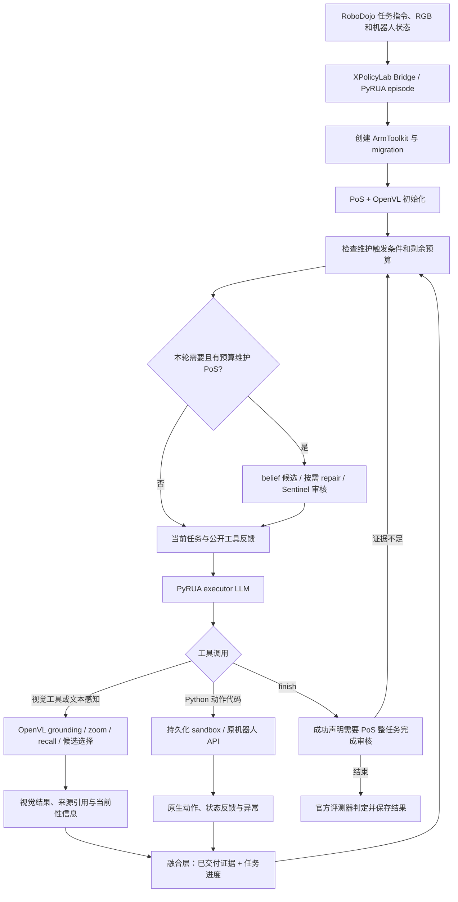

# Implementation pipeline

## 1. 系统定位

本实现以 **PyRUA-Lean 为 baseline**。PyRUA 提供任务 episode、模型调用、持久化 Python 执行、机器人原语、动作反馈和评测适配；PoS 维护任务 belief 与未完成项，OpenVL 提供可追溯的视觉工具和候选选择。主执行循环仍是 PyRUA 的 code-as-policy loop。

默认配置为 `v17_ablation / fusion`：PoS 使用 ProgressLite，OpenVL 采用 native visual tools + routed perception。融合层将已经交付的视觉证据送给 PoS，而不是另起一个 OpenVL agent 执行机器人动作。

## 2. 一条 episode 的数据流

图中“Python 动作代码”也可以调用感知方法：调用到文本定位/分割边界时，会进入 OpenVL 路由，再返回同一个 Python 单元的执行过程。

## 3. Episode 初始化

1. `Model._play()` 通过 XPolicyLab Bridge 调用 `play_episode()`，传入任务、模型、动作接口、预算和 migration。
2. PyRUA 构建 `ArmToolkit`，提供持久化 Python workspace、`robo` API 和工具反馈。
3. `configure_migration()` 解析配置。默认 `ablation_v17.build_harness()` 安装 `OpenVLRoutedAdapter` 为 `kit.evidence_adapter`，并将融合 harness 安装为 `kit.general_harness`。
4. 实际继承链为 `_FusionControl -> MinimalFusionHarness -> CompositeHarness -> ProgressLiteHarness -> ProgressHarness -> ScheduledPoSHarness -> PoSHarness`。类名中的历史版本/组合名不代表所有机制都启用，以配置开关为准。

## 4. PoS：任务状态与维护

PoS 将当前工作分为三个部分：

| 状态 | 含义 |
| --- | --- |
| `world` | 有来源关联的实体、状态和关系 belief |
| `epistemic` | 当前仍缺少的、影响决策的信息 |
| `achievement` / `active_gap` | 原始任务的未完成目标与当前关注项 |

维护不是每个动作都无条件调用模型。调度器根据初始状态、执行错误、抓取/释放、子目标变化、状态陈旧和完成请求等事件，在预算允许时触发维护。

维护使用原模型端点上的不同调用角色：`pos_belief` 生成候选 belief，必要时 `pos_repair` 修复候选，`pos_sentinel` 审核候选与后续方向。它们是预算内的辅助推理调用，不能直接执行机器人工具；不是额外训练出的模型。审核和协议检查决定候选能否提交，失败或超时时仍保留原始公开工具反馈。

ProgressLite 为 `python(code, step=...)` 提供可选的任务意图注解，例如 `goal`、`phase`、`expected`。注解问题会产生警告并修正 bookkeeping，不要求重放已经执行的机器人动作；不受证据支持的完成声明仍保持 uncertain。

## 5. OpenVL：视觉工具与感知路由

显式视觉工具包括 `Visual_Grounding_Tool`、`Zoom_In_Tool` 和 `Recall_Images`。native adapter 将工具接到已有的本地感知与图像处理后端，并管理 image ID、grounding binding、候选编号和来源上下文。

当 Python 中的文本感知调用被路由时：

1. 获取对应相机图像并生成候选区域及编号图。
2. 用配置的 score margin 和 mask overlap 启发式判断是否存在多个有竞争力的假设；这不是目标身份正确性的保证。
3. 若存在歧义，交付候选证据并抛出 `PerceptionChoiceRequired`，让 executor 查看编号图、显式选取候选后继续。普通 Python 若未捕获该异常，本单元后续代码停止；此前已经发生的动作不会回滚，也不会自动重放。
4. 若无需显式选择，则继续原始感知调用，保留其原有返回类型、误差与不确定性。

选中候选不等于证明目标身份、抓取成立或任务成功。Zoom/Recall 复用原图来源，不会把历史帧变成新观测；动作后依赖旧 grounding 的查询仍需通过时效检查。

## 6. 融合与闭环反馈

`CompositeHarness` 收集 executor 已实际收到的视觉 packet，将来源、当前性、候选及语义限制压缩为 `openvl_pos_handoff`。该 handoff 随公开动作反馈进入 PoS 的 belief/repair/Sentinel 输入，再形成下一轮 executor 的任务上下文与执行方向。

这条闭环是：**公开观测和工具结果 → belief 与未完成项 → executor 生成代码 → 原机器人接口执行 → 公开反馈 → 下一次决策**。executor 的文字报告只是报告，不会被直接当成已经验证的物理事实。

## 7. 完成判定与预算

- executor 发出 `finish(success)` 时，PoS 要求当前结果证据和覆盖原始任务要求的整任务审核；审核不足则返回继续工作的反馈。`failure/stuck` 仍可正常结束。
- PoS 内部批准结束不等于官方任务成功。episode 结束后的真实得分和成功状态由原官方评测器给出，不作为执行期间的隐藏观测注入模型。
- 默认策略配置为 100 turns、5400 秒总墙钟预算、单次输出上限 8192 tokens、`reasoning_effort=high`。未覆盖 runtime 默认值时，辅助推理子预算为总预算的 20%（1080 秒），在总预算内消耗。
- fusion 会产生 PoS 辅助推理调用；“相同总预算”不表示与 baseline 拥有相同的请求次数或 token 成本。复现对照应记录这些使用量。

当前 fusion 的配置展开后：`dependency_mode=off`、`observation_scope=baseline`，额外 reflection、static rules、action focus 和 reliability 机制均关闭。不要把源码中其他实验分支的机制当成当前 pipeline 的组成部分。

## 8. Baseline 对照

| 项目 | PyRUA baseline | PoS + OpenVL |
| --- | --- | --- |
| 生成配置 | `configure.py --variant baseline` | `configure.py` 或 `--variant fusion` |
| Migration | `kind=baseline` | `kind=v17_ablation, profile=fusion` |
| 主模型循环与 Python/机器人执行 | 原 PyRUA | 同一 PyRUA 执行栈 |
| PoS 维护与完成审核 | 不安装本扩展 | 启用 |
| OpenVL 视觉工作区和自动路由 | 不安装本扩展 | 启用 |
| 任务、动作接口、评分器 | 原 benchmark | 同一 benchmark |

baseline 指本仓库同一 PyRUA 执行栈的无扩展配置。对比时还需固定模型版本、任务布局和运行参数，保留全部官方结果。

## 9. 代码入口与观测位置

| 模块 | 文件 |
| --- | --- |
| 配置生成与 baseline/fusion 选择 | [scripts/configure.py](scripts/configure.py) |
| Benchmark episode 入口 | [model.py](source/integrations/xpolicylab/PyRUA_Lean/model.py) |
| 原主模型循环及辅助推理预算 | [openai_runtime.py](source/src/pyrualean/openai_runtime.py) |
| Toolkit 工具分发与执行前后 hooks | [arms.py](source/src/pyrualean/arms.py) |
| Migration 注册与安装 | [migrations.py](source/src/pyrualean/migrations.py) |
| 当前配置与组合工厂 | [ablation_fusion.json](source/integrations/migrations/general_harness/ablation_fusion.json)、[ablation_v17.py](source/src/pyrualean/ablation_v17.py) |
| PoS 核心、事件调度、轻量意图注解 | [pos_harness.py](source/src/pyrualean/pos_harness.py)、[pos_v4.py](source/src/pyrualean/pos_v4.py)、[progress_lite.py](source/src/pyrualean/progress_lite.py) |
| 融合层与有效开关 | [composite_harness.py](source/src/pyrualean/composite_harness.py)、[minimal_fusion.py](source/src/pyrualean/minimal_fusion.py) |
| 视觉工具、来源绑定与路由 | [openvl_visual.py](source/src/pyrualean/openvl_visual.py)、[openvl_routed.py](source/src/pyrualean/openvl_routed.py) |

运行时可检查 episode 的工具轨迹、PoS 目录下的 `events.jsonl`、workspace 相邻 `openvl_visual/` 下的视觉记录，以及 `harness_model/` 辅助推理记录。最终成绩以 benchmark 的官方结果文件为准；具体启动命令见 [REPRODUCTION.md](REPRODUCTION.md)。
